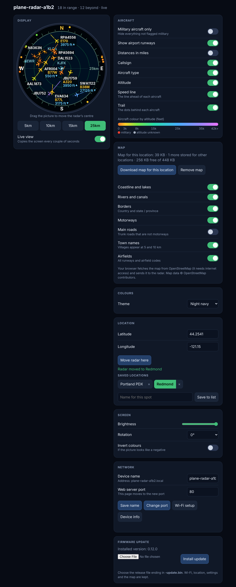
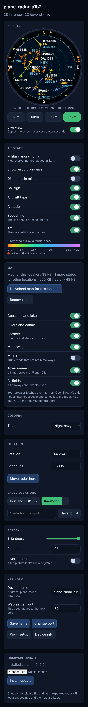

# C3-Radar

A live aircraft radar for your desk: an **ESP32-C3 Super Mini** and a **2.1" round 360×360 GC9B72 display** showing the planes around you, straight from the free [adsb.fi](https://opendata.adsb.fi/) feed. No receiver or antenna needed — just Wi-Fi.


*Rendered from live adsb.fi traffic with the firmware's own drawing code (see [PC preview](#pc-preview)).*

C3-Radar is a port of [MatixYo/ESP32-Plane-Radar](https://github.com/MatixYo/ESP32-Plane-Radar) (made for a 1.28" 240×240 GC9A01) to the larger GC9B72 panel, with redrawn graphics and a web page to control it.

> **Status: beta.** It runs on real hardware, but it is young. If something misbehaves, see [Troubleshooting](#troubleshooting) and please open an issue.

## Features

- **Sharp 360×360 graphics** — smooth fonts and rings, compass ticks, runway overlays for large airports.
- **Aircraft silhouettes** — jet, light aircraft and helicopter shapes that point along the heading, coloured by altitude, with a speed line and a short trail.
- **Readable tags** — callsign, type and altitude with a climb/descent arrow. Tags never overlap: in busy airspace, farther aircraft drop to callsign-only or no tag.
- **Military aircraft** — always drawn red with a ring, plus a **military-only** switch that hides everything else.
- **Local map** — coastline, lakes, rivers, borders, motorways, main roads, town names and airfields under the radar, each with its own switch. Downloaded once from OpenStreetMap through the web page.
- **Colour themes** — five built-in themes and a custom palette you can edit colour by colour.
- **Updates from the web page** — install new firmware over Wi-Fi without losing your settings.
- **Several radars on one network** — every unit gets its own name and address.
- **Web page** — a live copy of the screen, range buttons and every setting, from any phone or computer on your network.
- **Adjustable web server port** — move the web page off port 80 if you need to.
- **Easy Wi-Fi setup** — the device opens its own hotspot the first time; no code changes needed.

## What you need

| Part | Notes |
|---|---|
| ESP32-C3 Super Mini | 4 MB flash, USB-C |
| 2.1" round TFT, GC9B72, 360×360, SPI | The back of the board is marked `GC9B72` |
| 8 jumper wires | 7 if you skip the backlight wire |
| USB-C data cable | For flashing and power |

## Wiring

| Display pin | ESP32-C3 pin |
|---|---|
| VCC | **3V3** (do not use 5 V) |
| GND | GND |
| SCL | GPIO 4 |
| SDA | GPIO 3 |
| DC | GPIO 10 |
| CS | GPIO 1 |
| RST (RES) | GPIO 0 |
| BL (BLK) | GPIO 5 — optional; lets the brightness slider dim the backlight as well as the picture |

Pins are set in [`include/config.h`](include/config.h) if you need a different layout.

## Install the firmware

Each [release](https://github.com/ShadowStacker/C3-Radar/releases) has two files (also in [`firmware/`](firmware/)):

| File | Use it for |
|---|---|
| `…-full.bin` | First install over USB. Flashed at address **0x0**. Erases saved settings. |
| `…-update.bin` | Later updates from the radar's web page. Keeps everything. |

### First install, from a browser

1. Open [esptool-js](https://espressif.github.io/esptool-js/) in Chrome or Edge.
2. Put the board in download mode: hold **BOOT**, tap **RESET**, release **BOOT**.
3. Click **Connect** and pick the board's serial port.
4. Set the flash address to `0x0`, choose the `-full.bin` file, click **Program**.
5. Tap **RESET** when it finishes.

### First install, from the command line

```bash
pip install esptool
```

```bash
esptool.py --chip esp32c3 write_flash 0x0 firmware/c3-radar-full.bin
```

### Updating later

Open the radar's web page, scroll to **Firmware update**, choose the new `-update.bin` file and click **Install update**. The radar restarts on the new version with Wi-Fi, location, name, theme, settings and map all intact.

Flashing the `-full.bin` again over USB also works, but it wipes Wi-Fi and settings, so you would go through setup again.

Versions before 0.11 had no update slot. Moving from one of those needs one last USB flash.

## First-time setup


1. Power the board. The screen turns yellow and shows **Wi-Fi setup**.
2. On your phone or computer, join the Wi-Fi network shown on the screen, **`PlaneRadar-XXXX`** (the last four characters differ per device).
3. A setup page should open by itself. If it doesn't, browse to `http://192.168.4.1`.
4. Choose **Configure WiFi**, pick your home network and enter its password.
5. On the same form, enter your **latitude and longitude** (until you do, the radar is centred on Redmond Municipal Airport, Oregon) (right-click any spot in Google Maps to copy them). You can also set miles, runways, military-only, the web server port and a device name here.
6. Save. The device restarts its connection, shows **Connected** with its web address for a few seconds, then starts the radar.

## Reading the display


| On screen | Meaning |
|---|---|
| Centre dot | Your location |
| Rings | Distance; the green label on the right is the distance of the third ring |
| Aircraft shape | Jet, light aircraft or helicopter, pointing where the nose points |
| Aircraft colour | Altitude: orange (low) → yellow → green → cyan → blue → purple (high); grey if unknown |
| Red aircraft with a ring | Military |
| Line ahead of an aircraft | Direction of travel; longer means faster |
| Dots behind an aircraft | Where it has just been |
| Tag | Callsign (white), aircraft type (amber), altitude in feet (blue) with ▲ climbing or ▼ descending |
| Dots on the rim | Aircraft beyond the outer ring, shown at the correct bearing |
| Teal lines and four-letter codes | Runways and ICAO code of large airports |
| Thin blue, amber and dashed purple lines, grey names | The map: water, roads, borders and towns (see [The map](#the-map)) |
| `MIL ONLY` badge | The military-only filter is on |
| `NO DATA` badge | No aircraft data received for 30 seconds |

Aircraft on the ground are hidden.

### The BOOT button

| Action | Effect |
|---|---|
| Short press | Next range: 5 → 10 → 15 → 25 km |
| Hold 3 seconds | Erase Wi-Fi, location and all settings (including the name and web port), then restart in setup mode. The stored map is kept. |

## The web page

Once the radar is on your network, open the address shown on the **Connected** screen at start-up: either the IP address or the name, such as `http://plane-radar-a1b2.local`.

 

| Section | What it does |
|---|---|
| Display | Live copy of the screen, refreshed about every 2 seconds, and the range buttons. Drag the picture to move the radar's centre. |
| Aircraft | Military-only, runways and miles/kilometres switches; switches for each tag line (callsign, type, altitude), the speed line and the trail; and a key to the altitude colours |
| Map | Download or remove the map, and a switch for each map layer |
| Location | Latitude and longitude of the radar centre, and your list of saved locations |
| Colours | Theme picker and the custom colour editor |
| Screen | Brightness, rotation and an invert-colours fix |
| Firmware update | Shows the installed version and installs a new one |
| Network | Device name, web server port, plus links to Wi-Fi setup and device info |

Changes apply immediately and are remembered after a power cut.

### Saved locations

Under **Location** you can keep up to eight named spots. Type a name and click **Save to list** to add wherever the radar is centred now (or the coordinates in the boxes). Click a name to jump the radar there; click **×** to remove it. A location marked "· map" has its own stored map.

You can also drag the live picture with the mouse or a finger: the radar's centre moves by the same distance, at the current range.

### The map


*Rendered with coarse public-domain Natural Earth data; OpenStreetMap gives far more detail.*

1. Set your location first.
2. On the web page, under **Map**, click **Download map for this location**. Your browser fetches the area (about 40 km in every direction) from OpenStreetMap, shrinks it, and sends it to the radar. The browser needs internet access; it takes from a few seconds to a minute.
3. Switch layers on and off as you like:

| Switch | Shows | Colour |
|---|---|---|
| Coastline and lakes | Sea coast and lakes with a shoreline of 3 km or more | Blue |
| Rivers and canals | Rivers and canals | Darker blue |
| Borders | Country and state / province borders | Dashed purple |
| Motorways | Motorways | Amber |
| Main roads | Trunk roads that are not motorways (off by default) | Brown |
| Town names | Cities and towns; villages too at the 5 and 10 km ranges | Grey |
| Airfields | Every runway and airfield code in the area, not just large airports | Teal |

The map is kept in the device's flash memory and survives power cuts and firmware updates. The radar keeps up to eight maps, one per area, and automatically uses the one nearest its current centre (within 30 km). They share about 0.45 MB of storage; the Map section shows how much is free. A new map is simplified automatically to fit the space that is left, so if a busy area comes out too coarse, remove a map you no longer need and download it again. Map data © [OpenStreetMap](https://www.openstreetmap.org/copyright) contributors.

### Colour themes


Pick a theme under **Colours**: Night navy (default), Classic green, Amber, Night red or Daylight. Choose **Custom** to edit your own; it starts as a copy of whichever theme was showing. Each colour applies as soon as you pick it:

| Colour | Used for |
|---|---|
| Background, Scope | Outside and inside the outer ring |
| Grid | Rings, crosshair, ticks and the range label |
| Compass text | N / E / S / W and the centre mark |
| Aircraft | All aircraft, when **Colour aircraft by altitude** is off |
| Callsign, Aircraft type, Altitude text | The three tag lines |
| Airports, Water, Roads, Borders, Town names | Map layers |
| Military | Military aircraft and the `MIL ONLY` badge |

### More than one radar

Each device names itself `plane-radar-xxxx`, using four characters from its chip, so two radars never share an address or a setup hotspot. To give one a friendlier name, enter it under **Network → Device name**: "Kitchen Radar" becomes `http://kitchen-radar.local`. Both can stay on port 80, because each has its own IP address.

adsb.fi allows about one request per second from your home connection. Each radar asks every 5 seconds, so a handful is fine.

### Changing the web server port

Enter a port from 1 to 65535 under **Network** and click **Change port**. The web server restarts and your browser follows it to the new address, for example `http://plane-radar-a1b2.local:8080`.

- The setup hotspot always uses port 80.
- The **Connected** screen at start-up shows the current address and port.
- Forgot the port? Hold **BOOT** for 3 seconds to reset everything.

### Military-only mode

adsb.fi marks aircraft that its database lists as military. With the switch on, only those are fetched and drawn, and the screen shows a `MIL ONLY` badge so an empty radar isn't mistaken for a fault. Coverage depends on that database, and military aircraft that don't broadcast their position won't appear.

## Troubleshooting

| Problem | Try this |
|---|---|
| Screen stays black | Check VCC is on 3V3 and every wire against the table. If BL is wired, check it goes to GPIO 5; if not, leave it unconnected. |
| Colours look like a photo negative | Web page → Screen → **Invert colours** |
| Red and blue are swapped | Your panel uses the other colour order: set `kDisplayRgbOrder` to `false` in `include/config.h` and rebuild |
| Picture is sideways or upside down | Web page → Screen → **Rotation** |
| The `.local` address doesn't open | Use the IP address from the **Connected** screen or your router's device list; add `:port` if you changed the port |
| No aircraft | Check the location is right, try the 25 km range, and make sure military-only is off |
| `NO DATA` badge | The device can't reach adsb.fi; check your internet connection |
| Stuck on the yellow **Could not connect** screen | Hold **BOOT** for 3 seconds and run setup again |
| Firmware update says "not an update file" | Choose the file ending in `-update.bin`, not `-full.bin` |

For more detail, connect over USB and open a serial monitor at 115200 baud.

## Build from source

You need [PlatformIO](https://platformio.org/install/cli).

```bash
pio run -e supermini -t upload
```

```bash
pio device monitor
```

To make the full image for USB flashing (written to `.pio/build/supermini/firmware-merged.bin`; the update image is `firmware.bin` next to it):

```bash
pio run -e supermini -t merge
```

Pushing a tag such as `v1.0.0` makes GitHub Actions build the firmware and attach it to a release.

### Where things are

| Path | Contents |
|---|---|
| `include/config.h` | Pins, default location, timings |
| `include/ui/radar_theme.h` | Layout |
| `src/ui/theme.cpp` | Colour themes |
| `partitions/plane_radar.csv` | Flash layout: two firmware slots and map storage |
| `src/ui/radar_display.cpp` | Radar drawing |
| `src/ui/map_layer.cpp`, `src/services/map_store.cpp` | Map drawing and flash storage |
| `src/services/web_ui.cpp`, `web_page.h` | Web page and its API |
| `src/services/adsb_client.cpp`, `adsb_store.cpp` | adsb.fi download and parsing |
| `src/services/wifi_setup.cpp` | Wi-Fi setup and web server start-up |
| `scripts/` | Generators for fonts, aircraft icons and the airport database |
| `tools/host_preview/` | PC preview build |

### Regenerating assets

```bash
python3 scripts/build_fonts.py path/to/Font-Bold.otf
```

```bash
python3 scripts/build_aircraft_icons.py --preview icons.png
```

```bash
python3 scripts/build_large_airports.py
```

The embedded fonts are [Inter](https://rsms.me/inter/) Bold (SIL Open Font License).

### PC preview

`tools/host_preview` compiles the firmware's drawing code for a computer and renders the screen to a BMP from a saved adsb.fi response, so you can change the graphics without flashing a board. Run one build first so PlatformIO downloads the libraries.

```bash
tools/host_preview/build.sh
```

```bash
curl -o snapshot.json "https://opendata.adsb.fi/api/v3/lat/40.64/lon/-73.78/dist/21"
```

```bash
mkdir -p out && tools/host_preview/host_preview data out 40.64 -73.78 3 0 snapshot.json
```

Set `C3_MAP=<map file>` to draw a map saved from the web page's builder, and `C3_MAP_LAYERS=<number>` to choose layers.

The arguments are: font folder, output folder, latitude, longitude, range index (0–3), military-only (0 or 1), then one or more snapshots.

### Web API

| Request | Purpose |
|---|---|
| `GET /api/state` | Current settings and aircraft counts as JSON |
| `POST /api/settings` | Form fields, any subset of: `lat`, `lon`, `range`, `place_add`, `place_go`, `place_del`, `mil`, `miles`, `runways`, `ac_show`, `map_layers`, `name`, `theme`, `custom`, `custom_alt`, `brightness`, `rotation`, `invert`, `port` |
| `GET /screen.bmp` | The current screen as a 360×360 BMP |
| `POST /api/map` | Upload a map file (multipart form); the format is described in `include/ui/map_layer.h` |
| `POST /api/map/delete` | Remove the map in use (or map number `i`) |
| `POST /api/update` | Install an update image (multipart form) |

The web page has no password; anyone on your network can open it.

## Credits and licence

- Original project: [ESP32-Plane-Radar](https://github.com/MatixYo/ESP32-Plane-Radar) by MatixYo.
- Aircraft data: [adsb.fi open data](https://opendata.adsb.fi/). Airport data: [OurAirports](https://ourairports.com/). Map data: © [OpenStreetMap](https://www.openstreetmap.org/copyright) contributors, via the Overpass API.
- Libraries: [LovyanGFX](https://github.com/lovyan03/LovyanGFX), [WiFiManager](https://github.com/tzapu/WiFiManager), [ArduinoJson](https://github.com/bblanchon/ArduinoJson).

Released under the [MIT licence](LICENSE).
