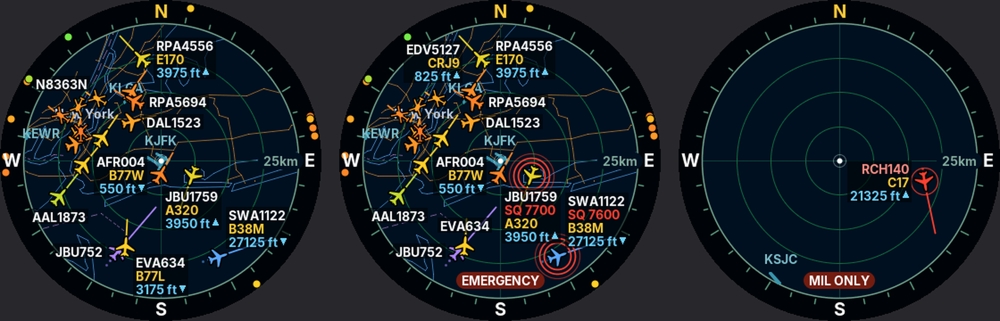
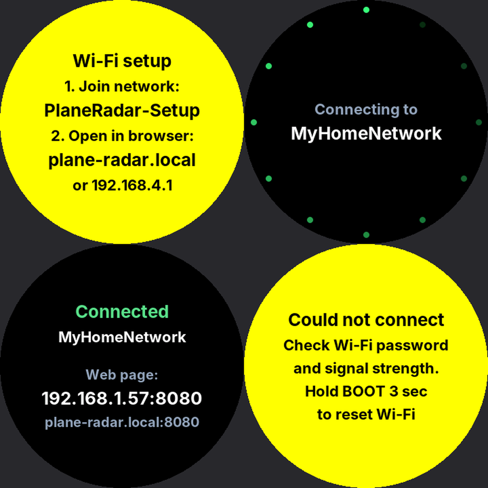
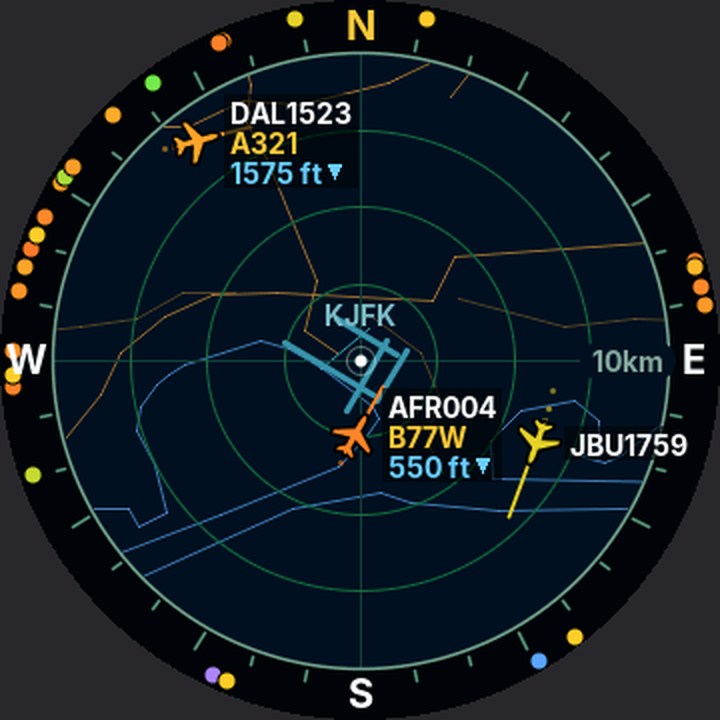
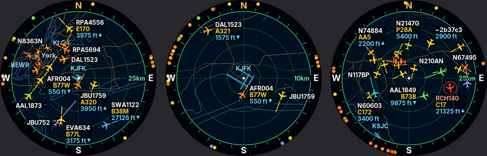
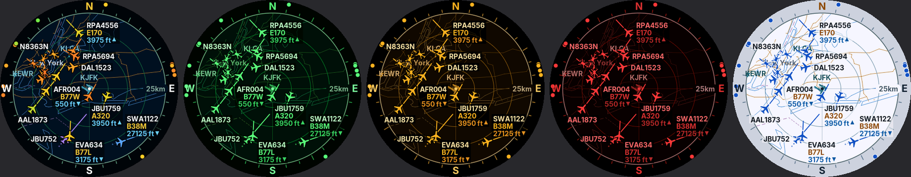

# C3-Radar

A live aircraft radar for your desk. An **ESP32-C3 Super Mini** or **ESP32-S3 SuperMini** drives a **2.1" round 360×360 GC9B72 display** showing the planes around you, taken from free community ADS-B feeds. No receiver or antenna needed — just Wi-Fi.



*Rendered from captured live traffic with the firmware's own drawing code (see [PC preview](#pc-preview)). The emergency in the middle picture is simulated, and the map lines use coarse Natural Earth data; OpenStreetMap gives more detail on a real device.*

C3-Radar started as a port of [MatixYo/ESP32-Plane-Radar](https://github.com/MatixYo/ESP32-Plane-Radar) (made for a 1.28" 240×240 GC9A01) to the larger GC9B72 panel, and has grown a web page, maps, themes and over-the-air updates.

> **Status: beta.** The ESP32-C3 build runs on real hardware. The ESP32-S3 build compiles and passes the same tests but is newer and less proven. If something misbehaves, see [Troubleshooting](#troubleshooting) and please open an issue.

## Contents

- [Features](#features)
- [What you need](#what-you-need) · [Wiring](#wiring) · [Install the firmware](#install-the-firmware) · [First-time setup](#first-time-setup)
- [Reading the display](#reading-the-display)
- [The web page](#the-web-page): [locations](#locations), [map](#the-map), [aircraft options](#aircraft-options), [themes](#colour-themes), [updates](#updating-the-firmware), [health](#device-health), [network](#network-settings)
- [Troubleshooting](#troubleshooting)
- [Build from source](#build-from-source)

## Features

**On the display**

- Sharp 360×360 graphics: smooth fonts and rings, compass ticks, runways of large airports.
- Aircraft drawn as jet, light-aircraft or helicopter shapes pointing along their heading, coloured by altitude, with a speed line ahead and a trail behind.
- Tags with callsign, type and altitude, plus a climb or descent arrow. Tags never overlap: in busy airspace, farther aircraft drop to one line or none.
- Military aircraft in red with a ring, and a military-only mode.
- Emergency alerts for squawk 7500, 7600 and 7700: flashing rings, a red squawk line and an `EMERGENCY` badge.
- A local map under the traffic: coastline, lakes, rivers, borders, motorways, main roads, town names and airfields.
- Five colour themes and a fully custom palette.

**On the web page**

- A live copy of the screen that you can drag to move the radar.
- Saved locations, each with its own map.
- A switch for every tag line, the speed line, the trail and each map layer.
- Firmware updates over Wi-Fi that keep all your settings.
- A health readout: memory, redraw time, Wi-Fi signal, data feed.

**Under the hood**

- Automatic backup data feeds if the main one stops answering.
- Easy Wi-Fi setup through the device's own hotspot.
- Every radar gets its own name and address, so several can share a network.

## What you need

| Part | Notes |
|---|---|
| ESP32-C3 Super Mini **or** ESP32-S3 SuperMini | 4 MB flash, USB-C. The S3 (ESP32-S3FH4R2) is faster and has more memory; both run the same features. |
| 2.1" round TFT, GC9B72, 360×360, SPI | The back of the board is marked `GC9B72` |
| 8 jumper wires | 7 if you skip the backlight wire |
| USB-C data cable | For flashing and power |

## Wiring

| Display pin | ESP32-C3 Super Mini | ESP32-S3 SuperMini |
|---|---|---|
| VCC | **3V3** (do not use 5 V) | **3V3** (do not use 5 V) |
| GND | GND | GND |
| SCL | GPIO 4 | GPIO 12 |
| SDA | GPIO 3 | GPIO 11 |
| CS | GPIO 1 | GPIO 10 |
| DC | GPIO 10 | GPIO 9 |
| RST (RES) | GPIO 0 | GPIO 8 |
| BL (BLK) | GPIO 5 (optional) | GPIO 13 (optional) |

- On the S3 SuperMini these are eight neighbouring pins on one edge of the board, in this order: `3V3, GND, 13, 12, 11, 10, 9, 8`. Look-alike boards exist with a different pin order, so check the labels printed on yours.
- BL is optional. The brightness slider dims the picture either way, and also dims the backlight when BL is wired.
- The button is the board's own BOOT button on both boards.
- Pins are set in [`include/config.h`](include/config.h) if you need a different layout.

## Install the firmware

Each [release](https://github.com/ShadowStacker/C3-Radar/releases) has two files per board (also in [`firmware/`](firmware/)). Pick the pair for your board: `esp32c3` or `esp32s3`.

| File | Use it for |
|---|---|
| `…-full.bin` | First install over USB. Flashed at address **0x0**. Erases saved settings. |
| `…-update.bin` | Later updates from the radar's web page. Keeps everything. |

### From a browser

1. Open [esptool-js](https://espressif.github.io/esptool-js/) in Chrome or Edge.
2. Put the board in download mode: hold **BOOT**, tap **RESET**, release **BOOT**.
3. Click **Connect** and pick the board's serial port.
4. Set the flash address to `0x0`, choose the `-full.bin` file for your board, click **Program**.
5. Tap **RESET** when it finishes.

### From the command line

```bash
pip install esptool
```

For the C3:

```bash
esptool.py --chip esp32c3 write_flash 0x0 firmware/c3-radar-esp32c3-full.bin
```

For the S3:

```bash
esptool.py --chip esp32s3 write_flash 0x0 firmware/c3-radar-esp32s3-full.bin
```

After that, updates go through the web page: see [Updating the firmware](#updating-the-firmware).

## First-time setup



1. Power the board. The screen turns yellow and shows **Wi-Fi setup**.
2. On your phone or computer, join the Wi-Fi network shown on the screen, **`PlaneRadar-XXXX`** (the last four characters differ per device).
3. A setup page should open by itself. If it doesn't, browse to `http://192.168.4.1`.
4. Choose **Configure WiFi**, pick your home network and enter its password.
5. Optionally enter your latitude and longitude on the same form. You can also do this later from the web page, which is easier. Until you do, the radar is centred on Redmond Municipal Airport, Oregon.
6. Save. The device shows **Connected** with its web address for a few seconds, then starts the radar.

## Reading the display



| On screen | Meaning |
|---|---|
| Centre dot | Your location |
| Rings | Distance; the label on the right is the distance of the third ring |
| Aircraft shape | Jet, light aircraft or helicopter, pointing where the nose points |
| Aircraft colour | Altitude: orange (low) → yellow → green → cyan → blue → purple (high). The web page shows the full scale. |
| Red aircraft with a ring | Military |
| Flashing red rings, red `SQ 7700` line | An aircraft declaring an emergency: 7500 hijack, 7600 radio failure, 7700 general. Always shown, even in military-only mode. |
| Line ahead of an aircraft | Direction of travel; longer means faster |
| Dots behind an aircraft | Where it has just been |
| Tag | Callsign, aircraft type, and altitude in feet with ▲ climbing or ▼ descending |
| Dots on the rim | Aircraft beyond the outer ring, shown at the correct bearing |
| Teal lines and four-letter codes | Runways and codes of airports |
| Thin blue, amber and dashed purple lines, grey names | The map: water, roads, borders and towns |
| `EMERGENCY` badge | At least one aircraft in view is declaring an emergency |
| `MIL ONLY` badge | The military-only filter is on |
| `NO DATA` badge | No aircraft data received for 30 seconds |

Aircraft on the ground are hidden. Colours in this table are those of the default theme.

### The BOOT button

| Action | Effect |
|---|---|
| Short press | Next range: 5 → 10 → 15 → 25 km |
| Hold 3 seconds | Erase Wi-Fi, location and all settings, then restart in setup mode. Stored maps are kept. |

## The web page

Once the radar is on your network, open the address shown on the **Connected** screen at start-up: either the IP address or the name, such as `http://plane-radar-a1b2.local`.

 

| Section | What it does |
|---|---|
| Display | Live copy of the screen, refreshed about every 2 seconds, and the range buttons |
| Aircraft | Military-only, runways, units, what to show for each aircraft, and the altitude colour key |
| Map | Download or remove a map, and a switch for each layer |
| Location | Where the radar is centred, and your saved locations |
| Colours | Theme picker and the custom colour editor |
| Screen | Brightness, rotation and an invert-colours fix |
| Network | Device name and web server port, plus links to Wi-Fi setup and device info |
| Device health | How the device is doing |
| Firmware update | The installed version, and installing a new one |

Changes apply immediately and are remembered after a power cut.

### Locations

There are three ways to move the radar:

- **Type coordinates** into Latitude and Longitude and click **Move radar here**. You can paste a pair copied from a map, such as `44.2541, -121.1500`, straight into the Latitude box.
- **Drag the live picture** with the mouse or a finger. The centre moves by the same distance at the current range.
- **Click a saved location.**

To save a spot, type a name and click **Save to list**. You can keep up to eight. Click **×** to remove one. A location marked "· map" has its own stored map.

### The map



*Rendered with coarse Natural Earth data; OpenStreetMap gives far more detail.*

1. Move the radar to where you want the map.
2. Under **Map**, click **Download map for this location**. Your browser fetches about 40 km in every direction from OpenStreetMap, shrinks it, and sends it to the radar. The browser needs internet access; it takes from a few seconds to a minute.
3. Switch layers on and off as you like:

| Switch | Shows |
|---|---|
| Coastline and lakes | Sea coast, and lakes with a shoreline of 3 km or more |
| Rivers and canals | Rivers and canals |
| Borders | Country and state / province borders (dashed) |
| Motorways | Motorways |
| Main roads | Trunk roads that are not motorways (off by default) |
| Town names | Cities and towns; villages too at the 5 and 10 km ranges |
| Airfields | Every runway and airfield code in the area, not just large airports |

Things to know:

- Maps live in the device's flash memory and survive power cuts and firmware updates.
- The radar keeps up to eight maps and automatically uses the one nearest its centre, within 30 km.
- All maps share about 0.45 MB. The Map section shows how much is free.
- A new map is simplified to fit the space that is left. If a busy area comes out too coarse, remove a map you no longer need and download again.
- Downloading a map for a spot replaces only the map for that same area.

Map data © [OpenStreetMap](https://www.openstreetmap.org/copyright) contributors.

### Aircraft options

| Switch | Effect |
|---|---|
| Military aircraft only | Hides everything not flagged military and shows a `MIL ONLY` badge, so an empty radar isn't mistaken for a fault |
| Show airport runways | Runways of large airports from the built-in database |
| Distances in miles | Range labels in miles instead of kilometres |
| Callsign, Aircraft type, Altitude | Each line of the tag |
| Speed line | The line ahead of each aircraft |
| Trail | The dots behind each aircraft |

Below the switches is a key to the altitude colours, from 0 to 42,000 ft and above. It is hidden for themes that draw all aircraft in one colour.

Military status comes from the data feed's aircraft database, so coverage depends on that database, and military aircraft that don't broadcast their position won't appear.

### Colour themes



Pick a theme under **Colours**: Night navy (default), Classic green, Amber, Night red or Daylight. Choose **Custom** to edit your own; it starts as a copy of whichever theme was showing, and each colour applies as soon as you pick it.

| Colour | Used for |
|---|---|
| Background, Scope | Outside and inside the outer ring |
| Grid | Rings, crosshair, ticks and the range label |
| Compass text | N / E / S / W and the centre mark |
| Aircraft | All aircraft, when **Colour aircraft by altitude** is off |
| Callsign, Aircraft type, Altitude text | The three tag lines |
| Airports, Water, Roads, Borders, Town names | Map layers |
| Military | Military aircraft, emergency markers and the badges |

### Updating the firmware

Under **Firmware update**, choose the new `-update.bin` file for your board and click **Install update**. The radar restarts on the new version with Wi-Fi, locations, name, theme, settings and maps intact.

- A file for the other board, or a `-full.bin`, is refused with a message.
- Flashing a `-full.bin` over USB also works, but it wipes Wi-Fi and settings.
- Versions before 0.11 have no update slot; moving from one of those needs one USB flash.

### Device health

| Row | What it tells you |
|---|---|
| Board | Chip type and cores |
| Running for | Time since the last restart |
| Free memory | Now, the lowest it has been, and the largest free block |
| Screen redraw | Time to draw and send one frame |
| Wi-Fi signal | Strength in dBm, with a plain-language rating |
| Aircraft data | Which feed is in use and how long the last request took |
| Requests | How many succeeded and failed |
| Firmware | Version and how full its slot is |

### Network settings

**Device name.** Each radar names itself `plane-radar-xxxx`, using four characters from its chip, so two radars never share an address or a setup hotspot. To rename one, enter a name under **Network**: "Kitchen Radar" becomes `http://kitchen-radar.local`.

**Web server port.** Enter a port from 1 to 65535 and click **Change port**. The web server restarts and your browser follows it, for example to `http://plane-radar-a1b2.local:8080`. The setup hotspot always uses port 80, and the **Connected** screen shows the current address and port. Several radars can all stay on port 80, because each has its own IP address.

**Data feeds.** The radar normally reads [adsb.fi](https://opendata.adsb.fi/). After two failed requests in a row it moves to [adsb.lol](https://www.adsb.lol/), then [airplanes.live](https://airplanes.live/), and tries adsb.fi again every 15 minutes. The status line at the top of the page says "backup feed" while one is in use. Each radar asks once every 5 seconds; the feeds allow about one request per second from a home connection, so a handful of radars is fine.

**Security.** The web page has no password. Anyone on your Wi-Fi can change settings or install firmware.

## Troubleshooting

| Problem | Try this |
|---|---|
| Screen stays black | Check VCC is on 3V3 and every wire against the table for your board. If BL is wired, check it goes to the BL pin in the table; if not, leave it unconnected. |
| Colours look like a photo negative | Web page → Screen → **Invert colours** |
| Red and blue are swapped | Your panel uses the other colour order: set `kDisplayRgbOrder` to `false` in `include/config.h` and rebuild |
| Picture is sideways or upside down | Web page → Screen → **Rotation** |
| The `.local` address doesn't open | Use the IP address from the **Connected** screen or your router's device list; add `:port` if you changed the port |
| No aircraft | Check the location, try the 25 km range, and make sure military-only is off |
| `NO DATA` badge | None of the data feeds can be reached. Check your internet connection; **Device health** shows the feed and the last request. |
| Location is refused | The message quotes what the radar received. Enter plain decimal numbers, such as `44.2541` and `-121.1500`. |
| Map download fails | The browser must be online. If only some layers fail, the page lists them; try again later. |
| Stuck on the yellow **Could not connect** screen | Hold **BOOT** for 3 seconds and run setup again |
| Firmware update is refused | Choose the `-update.bin` for your board, not a `-full.bin` and not the other board's file |
| Forgot the web port | Hold **BOOT** for 3 seconds to reset everything |

For more detail, connect over USB and open a serial monitor at 115200 baud.

## Build from source

You need [PlatformIO](https://platformio.org/install/cli). The two boards are separate build targets: `supermini` for the ESP32-C3 and `s3supermini` for the ESP32-S3.

```bash
pio run -e supermini -t upload
```

```bash
pio device monitor
```

To make the full image for USB flashing (written to `.pio/build/<target>/firmware-merged.bin`; the update image is `firmware.bin` next to it):

```bash
pio run -e supermini -t merge
```

Pushing a tag such as `v1.0.0` makes GitHub Actions build both boards and attach the four files to a release.

### Where things are

| Path | Contents |
|---|---|
| `include/config.h` | Pins for each board, default location, timings |
| `platformio.ini` | Build targets |
| `partitions/plane_radar.csv` | Flash layout: two firmware slots and map storage |
| `src/ui/radar_display.cpp` | Radar drawing |
| `src/ui/strip_canvas.cpp` | Low-level drawing into the strip buffer |
| `src/ui/theme.cpp` | Colour themes and the altitude colour scale |
| `src/ui/map_layer.cpp`, `src/services/map_store.cpp` | Map drawing and flash storage |
| `src/services/web_ui.cpp`, `web_page.h` | Web page and its API |
| `src/services/adsb_client.cpp`, `adsb_store.cpp` | Data feeds, download and parsing |
| `src/services/radar_location.cpp` | Location and saved locations |
| `src/services/wifi_setup.cpp` | Wi-Fi setup and web server start-up |
| `scripts/` | Generators for fonts, aircraft icons and the airport database |
| `tools/host_preview/` | PC preview build |

### How it fits on a small chip

- A full 360×360 frame is 259 KB, more than an ESP32-C3 can spare. Each frame is drawn in eight horizontal strips that share one 32 KB buffer.
- The C3 has no floating-point hardware, so per-pixel work (rings, lines, icons, blending) uses integers only. Aircraft icons are pre-rotated at build time.
- Maps are prepared in the browser and read straight from flash, so they use no RAM.
- The web page's screen copy re-draws the frame strip by strip into the network connection.

### Regenerating assets

```bash
python3 scripts/build_fonts.py path/to/Font-Bold.otf
```

```bash
python3 scripts/build_aircraft_icons.py --preview icons.png
```

```bash
python3 scripts/build_large_airports.py
```

The embedded fonts are [Inter](https://rsms.me/inter/) Bold (SIL Open Font License).

### PC preview

`tools/host_preview` compiles the firmware's drawing code for a computer and renders the screen to a BMP from a saved feed response, so you can change the graphics without flashing a board. Run one firmware build first so PlatformIO downloads the libraries.

```bash
tools/host_preview/build.sh
```

```bash
curl -o snapshot.json "https://opendata.adsb.fi/api/v3/lat/40.64/lon/-73.78/dist/21"
```

```bash
mkdir -p out && tools/host_preview/host_preview data out 40.64 -73.78 3 0 snapshot.json
```

The arguments are: font folder, output folder, latitude, longitude, range index (0–3), military-only (0 or 1), then one or more snapshots. Optional environment variables:

| Variable | Effect |
|---|---|
| `C3_THEME` | Preset theme number, 0–4 |
| `C3_MAP` | A map file saved from the web page's map builder |
| `C3_MAP_LAYERS` | Map layer switches as a number (127 = all) |
| `C3_AC_SHOW` | Aircraft display switches as a number (31 = all) |
| `C3_ADD_MS` | Extra milliseconds on the clock, for example to catch a flash phase |

### Web API

| Request | Purpose |
|---|---|
| `GET /api/state` | Settings, aircraft counts, alerts, saved locations, maps and health as JSON |
| `POST /api/settings` | Form fields, any subset of those below |
| `GET /screen.bmp` | The current screen as a 360×360 BMP |
| `POST /api/map` | Upload a map file (multipart form); the format is described in `include/ui/map_layer.h` |
| `POST /api/map/delete` | Remove the map in use (or map number `i`) |
| `POST /api/update` | Install an update image (multipart form) |

Fields accepted by `/api/settings`:

| Field | Meaning |
|---|---|
| `pos` | `latitude,longitude` (separate `lat` and `lon` also work) |
| `place_add`, `place_go`, `place_del` | Save the current centre under a name; jump to saved location N; remove saved location N |
| `range` | Range preset, 0–3 |
| `mil`, `miles`, `runways` | 0 or 1 |
| `ac_show` | Bit mask: 1 callsign, 2 type, 4 altitude, 8 speed line, 16 trail |
| `map_layers` | Bit mask: 1 coast and lakes, 2 rivers, 4 borders, 8 motorways, 16 main roads, 32 towns, 64 airfields |
| `theme` | Preset 0–4, or 255 for custom |
| `custom`, `custom_alt` | Fourteen `RRGGBB` values separated by commas; colour by altitude 0 or 1 |
| `brightness`, `rotation`, `invert` | 5–255; 0–3 quarter turns; 0 or 1 |
| `name`, `port` | Device name; web server port |

## Credits and licence

- Original project: [ESP32-Plane-Radar](https://github.com/MatixYo/ESP32-Plane-Radar) by MatixYo.
- Aircraft data: [adsb.fi](https://opendata.adsb.fi/), [adsb.lol](https://www.adsb.lol/) and [airplanes.live](https://airplanes.live/).
- Airport data: [OurAirports](https://ourairports.com/). Map data: © [OpenStreetMap](https://www.openstreetmap.org/copyright) contributors, via the Overpass API.
- Libraries: [LovyanGFX](https://github.com/lovyan03/LovyanGFX), [WiFiManager](https://github.com/tzapu/WiFiManager), [ArduinoJson](https://github.com/bblanchon/ArduinoJson).

Released under the [MIT licence](LICENSE).
